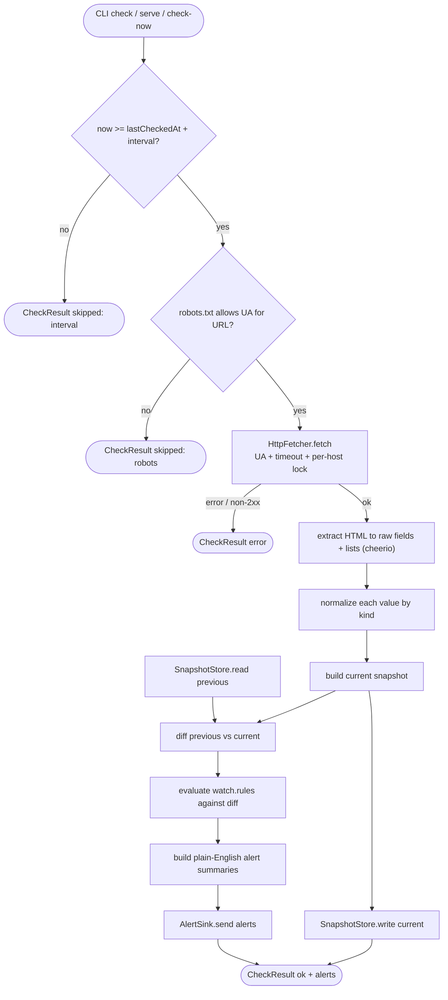
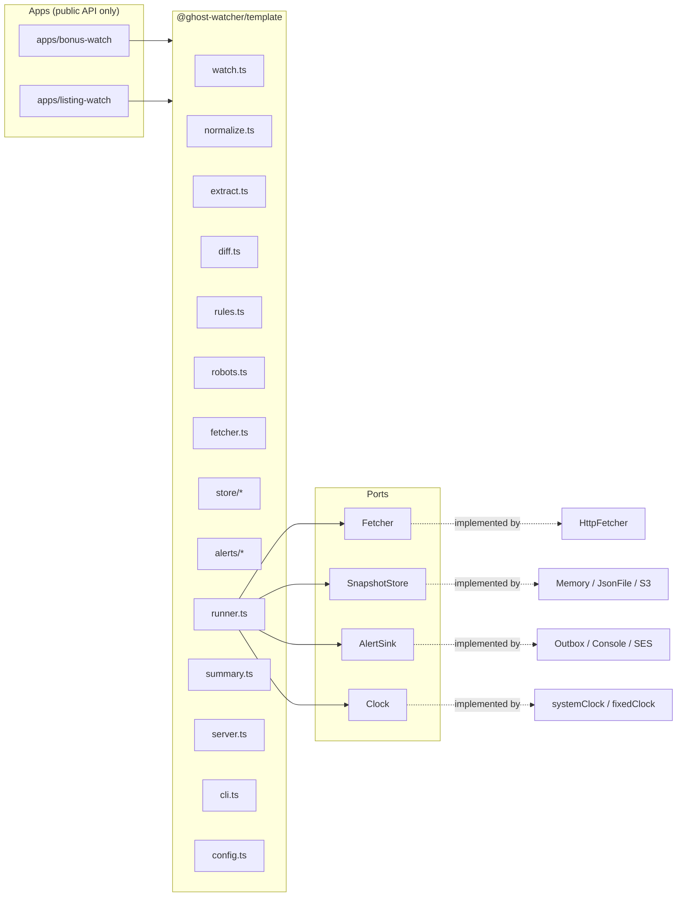

# Design: Ghost Watcher Kit

## 1. Goals and Scope

### In scope

- A reusable skeleton, package `@ghost-watcher/template`, providing watch definitions, a polite
  fetcher, a snapshot store, semantic diff with normalization, rules, alert sinks, a check runner, a
  CLI, and a ghostly dashboard.
- Two apps built only from the template's public API: `apps/bonus-watch` (sign-up bonus terms) and
  `apps/listing-watch` (apartment listings and city building permits).
- Local-first adapters (file store, memory store, outbox sink, console sink) with opt-in cloud adapters
  (S3 store, SES sink) selected by environment variable.
- Vitest unit/integration tests and Playwright end-to-end tests driven by local fixture servers.

### Out of scope

- Headless-browser scraping of logged-in or JavaScript-only pages.
- Bypassing paywalls, logins, CAPTCHAs, or robots.txt.
- Financial advice; bonus-watch reports what a page says, nothing more.

### Recorded assumption

"check now" (REQ-DASH-05) bypasses the per-URL minimum interval because it is an explicit,
user-initiated action, but it still honors robots.txt and per-host concurrency. The per-URL interval
gate (REQ-FETCH-03) applies to scheduled and CLI-triggered checks only.

## 2. Context and Constraints

Derived from the steering files:

- Stack: strict TypeScript, ES modules, Node.js 20+, `tsx` runtime, `tsc --noEmit` type check, cheerio
  for HTML, `node:http` for the server, Vitest + Playwright for tests.
- Adapters behind ports with free local defaults; cloud is opt-in via `GHOST_STORE` and `GHOST_ALERTS`.
- Politeness is non-negotiable: fetch and honor robots.txt first (cached), per-URL minimum interval
  default 6h honoring Crawl-delay, honest `User-Agent` with a contact URL, timeouts on every request,
  at most one request per host at a time, back off on errors.
- Pure functions for normalize, extract, diff, rules; side effects only in adapters and the runner.
- No `any`; discriminated unions for results.
- Tests never scrape live sites, never build real cloud clients, and never touch a network beyond
  `127.0.0.1`.

## 3. Architecture

The skeleton is a pipeline. Apps configure watches and rules; the runner drives the pipeline:
fetch (polite) -> extract (cheerio) -> normalize -> snapshot -> diff -> rules -> alerts -> store. The
dashboard reads the same watch registry and outbox to render ghosts and to expose a JSON API for
acknowledge and "check now".

Module layout follows `structure.md` exactly:

```
/template/src
  watch.ts        Watch, FieldSpec, ListSpec, Rule types; defineWatch helper
  normalize.ts    whitespace, money, number, date, percent, url normalizers
  extract.ts      HTML -> raw values via cheerio; applies normalizers
  diff.ts         pure semantic diff of two snapshots
  rules.ts        rule builders: wentUp, wentDown, changed, appeared, disappeared, newItem
  robots.ts       robots.txt parser, matcher, crawl-delay
  fetcher.ts      Fetcher port + HttpFetcher (robots, UA, timeout, per-host lock)
  store/          SnapshotStore port + Memory / JsonFile / S3 adapters
  alerts/         AlertSink port + Outbox / Console / SES adapters
  runner.ts       check runner orchestration
  summary.ts      plain-English alert sentences
  server.ts       node:http dashboard server + JSON API
  ui/             dashboard client script + stylesheet
  cli.ts          check and serve commands
  config.ts       environment-driven adapter selection + Clock
  index.ts        public API re-exports
```

### 3.1 Check-run pipeline



### 3.2 Components and ports



## 4. Adapter Interfaces (Ports)

All ports live in the template and are re-exported from `index.ts`. Result types use discriminated
unions with `ok` / `skipped` / `error` statuses.

### 4.1 Clock

```ts
export interface Clock {
  now(): Date;
}

export const systemClock: Clock; // Date.now()
export const fixedClock(at: Date | string): Clock; // for tests
```

### 4.2 Fetcher

The `HttpFetcher` owns robots.txt fetching and caching, the User-Agent, request timeouts, per-host
concurrency locking, and Crawl-delay. The per-URL minimum interval is enforced by the runner using the
persistent snapshot store, so it is honored across restarts.

```ts
export type FetchResult =
  | { status: 'ok'; html: string; finalUrl: string; fetchedAt: string }
  | { status: 'skipped'; reason: 'robots' | 'interval'; nextEligibleAt?: string }
  | { status: 'error'; message: string };

export interface Fetcher {
  fetch(url: string, opts?: { force?: boolean }): Promise<FetchResult>;
}

export interface HttpFetcherOptions {
  userAgent: string;        // GhostWatcher/<version> (+<contact url>)
  contactUrl: string;
  timeoutMs: number;
  robotsCacheMs: number;
  perHostConcurrency?: number; // default 1
}
```

### 4.3 SnapshotStore

```ts
export interface SnapshotStore {
  read(watchId: string): Promise<Snapshot | undefined>;
  write(snapshot: Snapshot): Promise<void>;
}
```

Local defaults: `MemorySnapshotStore` (tests) and `JsonFileSnapshotStore` (writes under
`<app>/.ghost-data/snapshots/`). Opt-in: `S3SnapshotStore` (AWS SDK v3) when `GHOST_STORE=s3`.

### 4.4 AlertSink

```ts
export interface AlertSink {
  send(alert: Alert): Promise<void>;
}
```

Local defaults: `OutboxAlertSink` (JSON Lines + rendered email files under
`<app>/.ghost-data/outbox/`) and `ConsoleAlertSink`. Opt-in: `SesEmailAlertSink` (Amazon SES v2) when
`GHOST_ALERTS=ses`.

## 5. Data Models

### 5.1 Watches, fields, lists, rules

```ts
export type FieldKind = 'text' | 'money' | 'number' | 'date' | 'percent';

export interface FieldSpec {
  name: string;
  selector: string;          // CSS selector for the value
  kind: FieldKind;
  attribute?: string;         // read this attribute (e.g. 'href') instead of text
  normalize?: NormalizeKind;  // override; defaults to the field kind
}

export interface ListFieldSpec {
  name: string;
  selector: string;           // CSS selector relative to the item element
  kind: FieldKind;
  attribute?: string;
}

export interface ListSpec {
  name: string;
  selector: string;           // CSS selector matching each item container
  fields: ListFieldSpec[];
  identityBy: string[];        // field names that identify an item for diffing
}

export type ItemFilterOp = 'eq' | 'lte' | 'gte' | 'contains';

export interface ItemFilter {
  field: string;
  op: ItemFilterOp;
  value: string | number;
}

export type Rule =
  | { kind: 'wentUp'; field: string; minDelta?: number }
  | { kind: 'wentDown'; field: string; minDelta?: number }
  | { kind: 'changed'; field: string }
  | { kind: 'appeared'; field: string }
  | { kind: 'disappeared'; field: string }
  | { kind: 'newItem'; list: string; filter: ItemFilter };

export interface Watch {
  id: string;
  name: string;
  url: string;
  fields: FieldSpec[];
  lists?: ListSpec[];
  rules: Rule[];
  intervalMs: number;        // default 6h when omitted via defineWatch
}

export function defineWatch(input: Omit<Watch, 'intervalMs'> & { intervalMs?: number }): Watch;
```

### 5.2 Normalized values

```ts
export type Normalized =
  | { kind: 'text'; value: string }
  | { kind: 'number'; value: number }
  | { kind: 'money'; amountMinor: number; currency: string }
  | { kind: 'date'; iso: string }          // YYYY-MM-DD
  | { kind: 'percent'; ratio: number }
  | { kind: 'absent' };

export type NormalizeKind = 'whitespace' | 'money' | 'number' | 'date' | 'percent' | 'url' | 'text';
```

Two `Normalized` values are **equal** when their canonical forms match (same kind and matching
canonical field(s)). Equality is what `diff` uses; inequality drives rule firing.

### 5.3 Snapshot and diff

```ts
export interface NormalizedItem {
  identity: string;                       // stable key from identityBy fields
  fields: Record<string, Normalized>;
}

export interface Snapshot {
  watchId: string;
  url: string;
  fetchedAt: string;                      // ISO timestamp
  fields: Record<string, Normalized>;
  lists: Record<string, NormalizedItem[]>;
}

export type FieldChange =
  | { type: 'added'; field: string; to: Normalized }
  | { type: 'removed'; field: string; from: Normalized }
  | { type: 'changed'; field: string; from: Normalized; to: Normalized };

export type ListChange =
  | { type: 'itemAdded'; list: string; item: NormalizedItem }
  | { type: 'itemRemoved'; list: string; item: NormalizedItem };

export interface Diff {
  fieldChanges: FieldChange[];
  listChanges: ListChange[];
}

export function diff(previous: Snapshot | undefined, current: Snapshot): Diff;
```

### 5.4 Alert and check result

```ts
export interface Alert {
  id: string;
  watchId: string;
  url: string;
  ruleKind: Rule['kind'];
  field?: string;
  list?: string;
  from?: Normalized;
  to?: Normalized;
  summary: string;                        // one plain-English sentence
  createdAt: string;                      // ISO timestamp
}

export type CheckResult =
  | { status: 'ok'; watchId: string; fetchedAt: string; diff: Diff; alerts: Alert[] }
  | { status: 'skipped'; watchId: string; reason: 'interval' | 'robots'; nextEligibleAt?: string }
  | { status: 'error'; watchId: string; message: string };
```

## 6. Check-Run Sequence

The runner performs, for one watch:

1. **Resolve** the watch from the registry.
2. **Read previous** snapshot from `SnapshotStore.read(watchId)` (used for both diff and the interval
   gate). For a manual "check now", skip the interval gate.
3. **Interval gate:** if `now < previous.fetchedAt + watch.intervalMs` (and not forced), return
   `skipped` with reason `interval` and `nextEligibleAt`.
4. **Robots gate:** the `HttpFetcher` consults its robots cache for the host; if robots disallows the
   watcher's User-Agent token for the URL, return `skipped` with reason `robots`.
5. **Fetch:** the `HttpFetcher` issues the page request with the honest User-Agent, a timeout, and the
   per-host lock; robots.txt and Crawl-delay are honored here.
6. **On fetch error** (network, timeout, non-2xx): return `error` with a message; produce no value
   alerts; surface an error state on the ghost card.
7. **Extract:** parse the HTML with cheerio; for each field spec, read the matched value (text or
   attribute); for each list spec, read each matched item and its item fields.
8. **Normalize:** apply the normalizer for each value's kind (or the spec override) to produce a
   `Normalized` value; URLs get tracking parameters stripped; whitespace is collapsed.
9. **Build current snapshot** (watchId, url, fetchedAt, normalized fields, normalized lists).
10. **Diff:** `diff(previous, current)` produces field and list changes. With no previous snapshot,
    fields are `added` and list items are `itemAdded`.
11. **Evaluate rules:** each rule in `watch.rules` is evaluated against the diff; matching rules
    produce candidate matches.
12. **Summarize:** `summary.ts` turns each match into one plain-English sentence naming what changed,
    from what to what, and which rule fired.
13. **Build alerts** with watch id, URL, rule kind, field or list, before/after, summary, and timestamp.
14. **Send alerts** through `AlertSink.send` for each alert.
15. **Write current snapshot** to `SnapshotStore.write`.
16. **Update dashboard state:** record last check status and mark the new alerts unacknowledged so the
    ghost glows.
17. **Return** `ok` with the diff and alerts.

## 7. Normalization Detail

Each normalizer is a pure function returning a `Normalized`. Equality of two normalized values is the
single source of truth for "did this value change?".

- **whitespace:** collapse runs of whitespace to a single space, trim ends. Applied to all `text`
  values before further normalization.
- **money:** parse a currency symbol/code and an amount; output `{ amountMinor, currency }` as an
  integer of minor units. `$1,200.00`, `$1200`, and `USD 1200.00` are equal.
- **number:** parse ignoring grouping separators; output `{ value: number }`. `1,234` equals `1234`.
- **date:** parse common formats to a canonical `YYYY-MM-DD` ISO date. `Jan 1, 2026` equals
  `2026-01-01`; a different date is unequal.
- **percent:** parse `50%` or `0.5` to a canonical ratio `0.5`.
- **url:** parse the URL, strip tracking query parameters (a known set plus any `utm_*`), and emit a
  canonical string so link changes differing only by tracking params do not alert.

If a value cannot be parsed for its kind, the normalizer falls back to a `text` value so that the
`changed` rule can still detect edits, while numeric rules (`wentUp`/`wentDown`) treat it as
non-numeric and do not fire on it.

## 8. Rules Detail

Rules are pure functions `(diff: Diff, rule: Rule) => Match[]`, where a `Match` carries the field/list,
before/after, and rule kind. The runner maps matches to alerts via `summary.ts`.

- **wentUp / wentDown:** apply only to `number` and `money` field changes of type `changed`; fire when
  the numeric value moved in the named direction, optionally requiring a `minDelta`.
- **changed:** fires on any field change of type `changed` (any kind) and on `added`/`removed` only if
  the rule is also meant to cover appearance; the default `changed` fires on `changed` only.
- **appeared:** fires on field changes of type `added`.
- **disappeared:** fires on field changes of type `removed`.
- **newItem:** fires on `itemAdded` list changes where the item matches the rule's `ItemFilter`.

Because rules consume the already-normalized diff, noise (whitespace, date format, tracking params,
page-generated stamps) is removed before rules run.

## 9. Dashboard Design

The dashboard is server-rendered HTML from `server.ts` plus one vanilla JS module and one stylesheet
under `ui/`, served with no build step.

**Ghost state** is derived from the watch registry, the outbox, and a small local dashboard-state file
(`<app>/.ghost-data/dashboard-state.json`) recording acknowledged alert ids and per-watch last check
status:

- **dormant** — last check ok and no unacknowledged alerts.
- **glowing** — one or more unacknowledged alerts exist.
- **error** — last check returned `error`.

**Routes (same `node:http` server):**

- `GET /` — server-rendered dashboard HTML with one ghost card per watch.
- `GET /api/ghosts` — JSON list of ghosts with state and last check summary.
- `GET /api/ghosts/:id` — JSON detail for one ghost including its recent alerts.
- `POST /api/ghosts/:id/acknowledge` — mark the ghost's current alerts acknowledged (ghost goes
  dormant).
- `POST /api/ghosts/:id/check` — trigger "check now" for that watch.
- `GET /ui/script.js`, `GET /ui/style.css` — static assets.

**Acknowledgment:** `POST /api/ghosts/:id/acknowledge` records the acknowledged alert ids in the
dashboard-state file so the glow does not return after a restart. A ghost glows only when there exist
outbox alerts for it newer than its last acknowledgment.

**Check now:** `POST /api/ghosts/:id/check` runs the runner with `force: true`, bypassing the per-URL
interval but still honoring robots.txt and per-host concurrency; the card shows an in-flight state
while the check runs.

**Accessibility and theme:** the haunted theme is applied via CSS with readable contrast; all controls
are keyboard operable; a `prefers-reduced-motion` media query disables glow animation and motion.

**Request guard (added after review):** every request passes `checkRequest` in `guard.ts` first. The
Host header must be loopback or listed in `GHOST_ALLOWED_HOSTS` (blocks DNS rebinding), and every
POST must carry no `Origin` or the dashboard's own origin, and no cross-site `Sec-Fetch-Site`.
Refusals are 403 with a JSON reason, before any check runs.

**Demo controls (added after review):** in `demo` mode the CLI records a baseline for every watch
before listening, and passes `demo.nextNight()` to the server. `POST /api/demo/next-night` advances
the fixture site, then runs `checkAll({ force: true })`, so one click shows a change.

## 10. Error Handling

- All cross-boundary results use discriminated unions (`ok` / `skipped` / `error`) per REQ-NF-03; the
  code never throws across module boundaries for expected conditions.
- **skipped** results (`interval`, `robots`) produce no alert and do not update the snapshot; the
  previous snapshot remains the baseline.
- **error** results (network, timeout, non-2xx, parse failure) produce no value-change alert; the ghost
  card shows an error state; the runner does not retry within the same check run. The next scheduled
  check re-attempts; if the error persists, the card stays in the error state.
- **Unparseable values** fall back to `text` (see Normalization Detail) so a `changed` rule still
  works and numeric rules safely skip.
- **Rules never throw:** a rule that cannot apply to a change (e.g. `wentUp` on a `text` change)
  returns no match rather than erroring.
- **Cloud adapters** are constructed lazily only when their environment variable is set, so the
  default local path never loads AWS SDK code.

## 11. Adapter Selection (config.ts)

Environment variables select adapters; the default is always local.

- `GHOST_CONTACT_URL` — required; used in the User-Agent. Missing it is a startup error (REQ-FETCH-02).
- `GHOST_STORE` — `json` (default) | `memory` | `s3`.
- `GHOST_ALERTS` — `outbox` (default) | `console` | `ses`.
- AWS adapter config (`GHOST_S3_BUCKET`, `GHOST_SES_FROM`, region, etc.) is read only when the
  corresponding cloud adapter is selected.

`config.ts` returns a `Deps` bundle the runner and server share:

```ts
export interface Deps {
  fetcher: Fetcher;
  store: SnapshotStore;
  alerts: AlertSink;
  clock: Clock;
}
```

## 12. Testing Strategy

### 12.1 Unit tests (Vest, `template/test/`)

- **normalize:** each kind with equality and inequality cases, plus noise cases (whitespace, date
  format, tracking-parameter URL, unparseable fallback) that assert no spurious inequality.
- **extract:** fixture HTML snippets -> expected raw then normalized values, including attribute
  reads and list extraction.
- **diff:** field `added`/`removed`/`changed`, list `itemAdded`/`itemRemoved`, first-run baseline, and
  noise cases asserting no change.
- **rules:** each builder with fire and no-fire cases, including `newItem` filter match/non-match.
- **robots:** parser, matcher, and crawl-delay extraction against fixture robots.txt content.
- **summary:** alerts rendered to single plain-English sentences.
- **adapters:** `OutboxAlertSink` writes to a temp outbox; `JsonFileSnapshotStore` round-trips a
  snapshot; `MemorySnapshotStore` read/write.

### 12.2 Integration tests (Vitest)

- The runner against a fake `Fetcher` (returns fixture HTML, `skipped`, or `error`) and
  `MemorySnapshotStore`, asserting the `ok` / `skipped` / `error` paths, that rules fire correctly, and
  that the outbox receives alerts on `ok`.

### 12.3 End-to-end tests (Playwright, per app)

- Start the app's fixture server (versioned pages + robots.txt + `/__fixture/advance` and
  `/__fixture/log`) and the app's dashboard.
- Drive the dashboard in a browser, assert the ghost is dormant initially.
- `POST /__fixture/advance` to a changed version, trigger or await a check, assert the ghost glows and
  an alert reaches the outbox.
- Assert acknowledge clears the glow and that "check now" re-runs.

### 12.4 Hermeticity rules

- Tests run only against `127.0.0.1`; no live-site scraping.
- Tests never construct real S3 or SES clients; cloud adapters are tested via fakes or not exercised.
- E2E runs use ports 3134–3137 to avoid colliding with dev ports 3130–3133.
