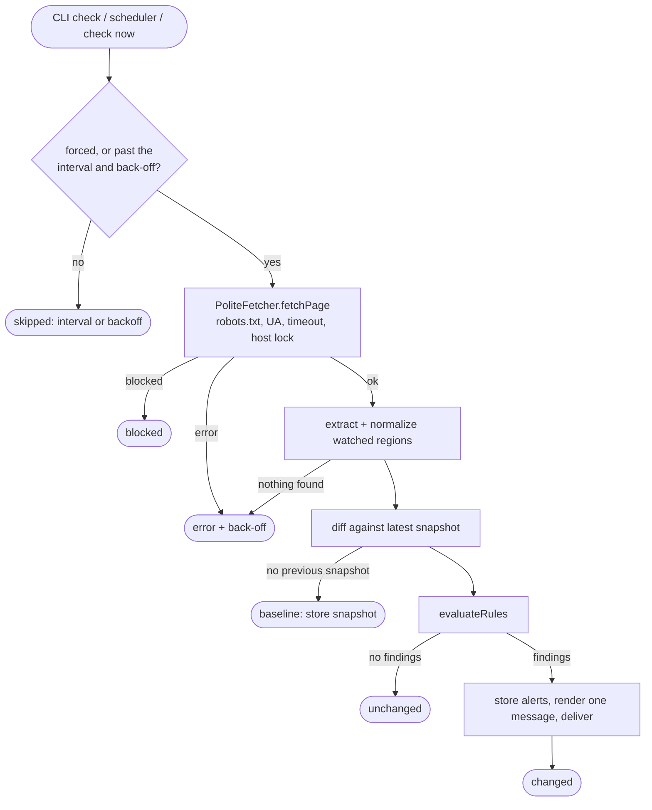
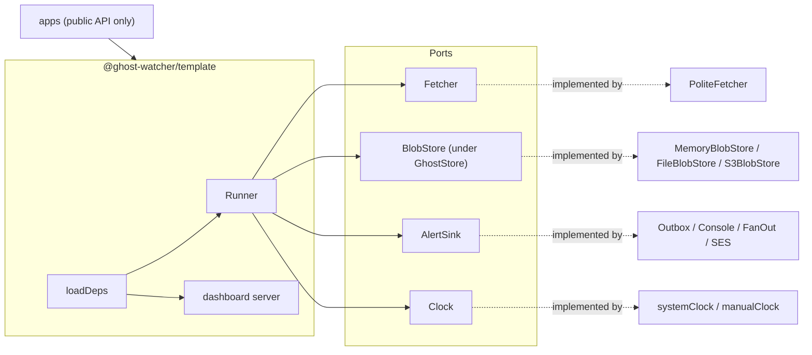

# Design: Ghost Watcher Kit

This document describes the code as built. Where the first draft differed, the code won and this text
was updated (pass 2). Requirement IDs refer to `requirements.md`.

## 1. Goals and Scope

### In scope

- A reusable skeleton, package `@ghost-watcher/template`, providing watch definitions, a polite
  fetcher, snapshot storage, semantic diff with normalization, rules, alert sinks, a check runner, a
  CLI, and a ghostly dashboard.
- Two apps built only from the template's public API: `apps/bonus-watch` (sign-up bonus terms) and
  `apps/listing-watch` (apartment listings and city building permits).
- Local-first adapters (file store, memory store, outbox sink, console sink) with opt-in cloud adapters
  (S3 store, SES sink) selected by environment variable.
- Vitest unit/integration tests and Playwright end-to-end tests driven by local fixture servers.

### Out of scope

- Headless-browser scraping of logged-in or JavaScript-only pages.
- Bypassing paywalls, logins, CAPTCHAs, or robots.txt.
- Financial advice; bonus-watch reports what a page says, nothing more.

### Recorded assumption

"Check now" (REQ-DASH-05) is a forced check: it bypasses the per-URL interval and the error back-off
because it is an explicit, user-initiated action, but it still honors robots.txt and the per-host
request gap. The interval gate (REQ-FETCH-03) applies to scheduled and CLI checks that are not forced.

## 2. Context and Constraints

Derived from the steering files:

- Stack: strict TypeScript, ES modules, Node.js 20+, `tsx` runtime, `tsc --noEmit` type check, cheerio
  for HTML, `node:http` for the server, Vitest + Playwright for tests.
- Adapters behind ports with free local defaults; cloud is opt-in via `GHOST_STORE` and `GHOST_ALERTS`.
- Politeness is non-negotiable: fetch and honor robots.txt first (cached), per-URL minimum interval
  default 6h, honest `User-Agent`, timeouts on every request, at most one request per host at a time,
  back off on errors.
- Pure functions for normalize, extract, diff, rules; side effects only in adapters and the runner.
- No `any`; discriminated unions for results.
- Money is integer minor units (cents) everywhere except display text.
- Tests never scrape live sites, never build real cloud clients, and never touch a network beyond
  `127.0.0.1`.

## 3. Architecture

The skeleton is a pipeline. Apps configure watches and rules; the runner drives the pipeline:
interval gate -> polite fetch -> extract (cheerio) -> normalize -> diff -> rules -> alerts -> store.
The dashboard reads the same app definition and store to render ghosts and exposes a JSON API.

Module layout (see `structure.md`):

```
/template/src
  watch.ts        Watch, FieldSpec, ListSpec, Rule types; defineWatch; rules and where builders
  normalize.ts    whitespace, money (integer cents), number, percent, date, url normalizers
  extract.ts      HTML -> normalized values via cheerio
  diff.ts         pure semantic diff of two extractions
  rules.ts        evaluates a watch's rules against a diff into findings
  summary.ts      plain-English sentences
  robots.ts       robots.txt parser, matcher, crawl-delay
  fetcher.ts      Fetcher port + PoliteFetcher; buildUserAgent
  store/          BlobStore port (memory, file, S3) + GhostStore
  alerts/         AlertSink port; outbox, console, fan-out and SES sinks; email renderer
  runner.ts       Runner: the check pipeline
  config.ts       environment-driven wiring (loadDeps), contact URL policy
  guard.ts        Host and Origin checks for the dashboard
  server.ts       node:http dashboard server and JSON API
  view.ts         view models for the dashboard
  ui/             render.js (shared renderer), app.js (client), style.css
  testing/        fixture site server (export "./testing")
  app.ts          defineApp
  cli.ts          check, serve, demo, list
  clock.ts        Clock port
  index.ts        public API
```

### 3.1 Check-run pipeline



### 3.2 Components and ports



## 4. Ports

### 4.1 Clock

```ts
export interface Clock { now(): Date; sleep(ms: number): Promise<void>; }
export const systemClock: Clock;
export function manualClock(start?: Date | string): ManualClock; // advance, set, slept
```

### 4.2 Fetcher

`PoliteFetcher` owns the robots.txt cache (one hour; ten minutes after a failure), the User-Agent,
timeouts (15 s), the per-host queue (one request at a time), the host gap (1 s) and Crawl-delay
(capped at 30 s), and a 2,000,000 character size cap. The interval gate lives in the runner and
reads the last attempt from the store, so it holds across restarts (REQ-FETCH-03).

```ts
export type FetchOutcome =
  | { status: 'ok'; html: string; finalUrl: string; httpStatus: number; fetchedAt: string }
  | { status: 'blocked'; reason: 'robots'; robotsUrl: string; fetchedAt: string }
  | { status: 'error'; message: string; httpStatus?: number; fetchedAt: string };

export interface Fetcher { fetchPage(url: string): Promise<FetchOutcome>; }
```

#### User-Agent and contact policy (REQ-FETCH-02, REQ-FETCH-SEC-01)

`buildUserAgent` produces one of two strings:

- `GhostWatcher/<version> (+<contact url>; page-change watcher)` for a real contact URL.
- `GhostWatcher/<version> (local-only, no public contact; page-change watcher)` when called with
  `localOnly: true` (the constant `LOCAL_ONLY_CONTACT`).

`GhostApp.contactUrl` is optional. `loadDeps` chooses the contact like this:

1. `configured` is `GHOST_CONTACT_URL` if set and non-blank, else the app's `contactUrl`.
2. A configured URL counts only if it is not a placeholder (`isPlaceholderContact`: a reserved host
   or not a valid URL).
3. If a real contact exists, use it.
4. Otherwise, if any watch targets a real host (`visitsThirdParty`), throw a `ConfigError` that names
   `GHOST_CONTACT_URL` (and the placeholder, if one was configured).
5. Otherwise every watch is on a loopback or reserved host, so use the local-only User-Agent.

The app definition that `loadDeps` returns never carries a placeholder contact. Both shipped apps
have no `contactUrl`.

### 4.3 Storage

`BlobStore` is a small key/value port over text documents: `get`, `put`, `list(prefix)`, `delete`.
Keys are validated and cannot escape the store. Adapters: `MemoryBlobStore`, `FileBlobStore` (under
`<data dir>/store/`, written atomically) and `S3BlobStore` (AWS SDK v3, loaded by dynamic import only
when `GHOST_STORE=s3`).

`GhostStore` keeps three kinds of documents on any blob store:

- `snapshots/<watch>/latest.json` and `snapshots/<watch>/history/<time>.json` (20 newest kept).
- `status/<watch>.json`: last attempt, last outcome and message, consecutive errors, check count,
  last change time and `acknowledgedAt`.
- `alerts/<watch>.json`: the newest 200 alerts.

When `GhostStore` reads a snapshot it upgrades money values written by earlier versions (a decimal
`value`) to integer `amountMinor`, so an upgrade raises no false change (REQ-STORE-05).

### 4.4 AlertSink

```ts
export interface AlertSink { readonly channel: string; deliver(message: AlertMessage): Promise<DeliveryReceipt>; }
```

`renderAlertMessage` turns one check's alerts into one message (subject, plain text, escaped HTML).
Sinks: `OutboxAlertSink` (JSON Lines index, `.eml`, HTML preview under `<data dir>/outbox/`),
`ConsoleAlertSink`, `FanOutAlertSink` (succeeds if any sink delivers) and `SesEmailAlertSink`
(Amazon SES v2, loaded only when `GHOST_ALERTS` includes `ses`).

## 5. Data Models

### 5.1 Watches, fields, lists, rules

```ts
export type FieldKind = 'text' | 'money' | 'number' | 'date' | 'percent' | 'url';

export interface FieldSpec { name; label?; selector; kind; attribute?; pattern? }
export interface ListFieldSpec { selector; kind; attribute?; pattern?; label? }
export interface ListSpec {
  name; label?; itemSelector;
  fields: Record<string, ListFieldSpec>;
  identity: string[];            // field names that identify an item
  describe?: string;             // "{beds} bd in {neighborhood} for {price}"
}

export type FilterOp = 'eq' | 'neq' | 'lt' | 'lte' | 'gt' | 'gte' | 'contains' | 'in';
export interface FilterCondition { field: string; op: FilterOp; value: string | number | Array<string | number> }
export type Severity = 'whisper' | 'moan' | 'shriek';

export type Rule =  // each also has optional label and severity
  | { kind: 'wentUp' | 'wentDown'; field: string; minDelta?: number }
  | { kind: 'changed'; field: string }
  | { kind: 'appeared' | 'disappeared'; field: string; matching?: string }
  | { kind: 'newItem' | 'itemRemoved'; list: string; where?: FilterCondition[] }
  | { kind: 'itemChanged'; list: string; field: string; direction?: 'up' | 'down'; where?: FilterCondition[] };

export interface Watch { id; name; url; subtitle?; fields; lists; rules; intervalMs; tags }
```

`defineWatch` validates and fills defaults (`intervalMs` 6 hours). `defineApp` checks unique watch ids.
The numbers in `minDelta` and in numeric `FilterCondition.value` are in the unit an app author
writes: major currency units for money fields.

### 5.2 Normalized values

```ts
export type Value =
  | { kind: 'text'; text: string }
  | { kind: 'number'; value: number; display: string }
  | { kind: 'money'; amountMinor: number; currency: string; display: string }  // integer cents
  | { kind: 'date'; iso: string; display: string }                            // YYYY-MM-DD
  | { kind: 'percent'; value: number; display: string }                       // percentage points
  | { kind: 'url'; href: string; display: string };
export type MaybeValue = Value | null;                                          // null: region not found
```

Two values are equal when their `canonical` keys match (for money: `money:<currency>:<amountMinor>`).

### 5.3 Extraction, snapshot and diff

```ts
export interface ListItem { key: string; values: Record<string, MaybeValue> }
export interface Extraction { fields: Record<string, MaybeValue>; lists: Record<string, ListItem[]> }
export interface Snapshot extends Extraction { watchId: string; url: string; takenAt: string }

export interface FieldChange { field; type: 'added' | 'removed' | 'changed'; before; after; delta?: number }
export type ListChange =
  | { type: 'itemAdded' | 'itemRemoved'; list: string; item: ListItem }
  | { type: 'itemChanged'; list: string; before: ListItem; after: ListItem; changes: FieldChange[] };
export interface Diff { firstRun: boolean; fields: FieldChange[]; lists: ListChange[] }
export function diff(previous: Extraction | undefined, current: Extraction): Diff;
```

`delta` is `after - before` for two values of the same numeric kind: integer cents for money, days for
dates, a plain difference otherwise.

### 5.4 Alert and check result

```ts
export interface Alert {
  id; watchId; watchName; url; createdAt; severity; ruleKind; ruleLabel; summary;
  field?; list?; before?; after?; item?;
}

export type CheckResult =
  | { status: 'baseline'; watchId; snapshot }
  | { status: 'unchanged'; watchId; snapshot; diff }
  | { status: 'changed'; watchId; snapshot; diff; alerts; delivery?; deliveryError? }
  | { status: 'skipped'; watchId; reason: 'interval' | 'backoff'; nextEligibleAt }
  | { status: 'blocked'; watchId; robotsUrl }
  | { status: 'error'; watchId; message };
```

## 6. Check-Run Sequence

`Runner.check(watch, { force })` does the following. Concurrent calls for one watch share one run.

1. Read the watch's status from `GhostStore`.
2. Unless forced, compute the next eligible time as the last attempt plus the larger of the watch
   interval and the error back-off; if it is in the future, return `skipped` (`interval`, or
   `backoff` after errors).
3. Fetch with `PoliteFetcher` (robots.txt first, one request per host, timeout).
4. On `blocked`, record status `blocked` and return `blocked`. On `error`, count a consecutive error
   and return `error`.
5. Extract and normalize. If no watched region was found, treat it as an error (layout changed) and
   keep the previous snapshot.
6. Read the latest snapshot and diff. With no previous snapshot, store this one and return `baseline`.
7. Evaluate rules (none on a first run). Store the new snapshot if anything changed.
8. With no findings, record `unchanged`.
9. With findings, build alerts, store them, render one message and deliver it. A delivery failure
   keeps the alerts and is returned as `deliveryError`.

Back-off after consecutive errors is 15 minutes, doubled per error, up to 24 hours. A successful
check resets it.

## 7. Normalization Detail

Each normalizer is a pure function. Unparseable values fall back to `text`, so `changed` still sees
edits while numeric rules ignore them.

- **whitespace:** collapse whitespace (including non-breaking spaces), trim, straighten smart quotes
  and dashes.
- **money:** find the first amount with a symbol or currency code (a bare number is the fallback),
  and read the whole and fraction digit strings as integers into `amountMinor` using `BigInt`
  (`minorFromDigits`): `(whole * 100 + fraction padded to two digits) * multiplier`. No floating point
  touches the digits. A `k` suffix multiplies by 1,000. A result above `Number.MAX_SAFE_INTEGER`
  yields no money value and falls back to text rather than rounding. `$1,234.56` is `123456`.
  - `formatMinor` turns cents back into text (`$300`, `$1,234.56`) with integer division; it is
    called only for `display`, summary sentences, alert emails and the dashboard.
  - `compareMinorToMajor` and `compareToTarget` compare cents with a target written in dollars by
    scaling both sides to integers with `BigInt`, so `where.atMost('price', 19.99)` is exact.
  - `numericValue` returns cents for money. Deltas are integer cents; `minDelta` is converted with
    `compareMinorToMajor`.
- **number:** parse ignoring grouping separators.
- **percent:** the number before `%` or `percent` (percentage points).
- **date:** ISO, `M/D/YYYY`, `Month D, YYYY` and `D Month YYYY`, with ordinals, to `YYYY-MM-DD`;
  impossible dates fall back to text.
- **url:** resolve against the page, lowercase the host, drop the fragment, `utm_*` and known
  tracking parameters, and sort the query.

## 8. Rules Detail

`evaluateRules(watch, diff)` is pure. It returns nothing for a first-run diff.

- **wentUp / wentDown:** field changes of type `changed` with a numeric delta and a kind other than
  date; fire when the delta has the named sign and meets `minDelta`.
- **changed:** field changes of type `changed`; dropped when a more specific rule fired for the field.
- **appeared / disappeared:** field changes of type `added` / `removed`, or with `matching`, when the
  pattern starts / stops matching the field text; the summary quotes the matching sentence.
- **newItem / itemRemoved:** `itemAdded` / `itemRemoved` changes whose item passes the filter.
- **itemChanged:** an `itemChanged` change whose named field changed, optionally only up or down.
- **Filters:** all conditions must hold. Text compares ignore case; numeric operators use
  `compareToTarget`, so money compares exactly in cents.
- **Dedupe:** one finding per change: the more specific field rule, and the loudest list rule per item.
- **Severity:** `shriek` for `newItem`, `whisper` for `itemRemoved`, `moan` otherwise, unless set.

## 9. Dashboard Design

Server-rendered HTML from `server.ts` using the shared renderer `ui/render.js`, plus `ui/app.js` and
`ui/style.css`, served with no build step.

**Ghost states** (from the stored status and alerts): `unborn` (never checked), `dormant`, `restless`
(unacknowledged alerts: the glow), `blocked` (robots.txt) and `lost` (the latest check errored).

**Routes:**

- `GET /` dashboard; `GET /healthz`; `GET /api/state`; `GET /api/ghosts/:id`.
- `POST /api/ghosts/:id/check` (forced check), `POST /api/ghosts/:id/acknowledge`,
  `POST /api/check-all`.
- `POST /api/demo/next-night` (demo mode only; 404 otherwise).
- `GET /outbox/:file.html` preview of an outbox letter; `GET /ui/*` assets and fonts.

**Acknowledgment:** stores `acknowledgedAt` in the status document. Alerts created at or before it
count as acknowledged, so the glow stays off after a restart and returns with a newer alert.

**Check now:** runs the runner with `force: true`; the card shows `data-checking` while the run is in
flight.

**Accessibility and theme:** the haunted theme uses CSS variables from the app theme with readable
contrast; controls are keyboard operable; `prefers-reduced-motion` disables animation.

**Request guard:** every request passes `checkRequest` in `guard.ts` first. The Host must be loopback
or listed in `GHOST_ALLOWED_HOSTS`, and every POST must carry no `Origin` or the dashboard's own, and
no cross-site `Sec-Fetch-Site`. Refusals are 403 before any check runs. Pages carry a strict
Content-Security-Policy.

**Demo controls:** in `demo` mode the CLI records a baseline for every watch before listening and
passes `demo.nextNight()` to the server. `POST /api/demo/next-night` advances the fixture site and
runs `checkAll({ force: true })`.

The dashboard footer shows the User-Agent in use, so a local-only run says so.

## 10. Error Handling

- Cross-boundary results are discriminated unions; expected conditions are not thrown.
- **skipped** results produce no alert and leave the snapshot alone.
- **blocked** and **error** results produce no value-change alert; the card shows `blocked` or `lost`.
  The runner does not retry within one run; the back-off delays the next unforced check.
- **Unparseable values** fall back to text (section 7).
- **Delivery failures** keep the stored alerts and are reported on the result.
- **Cloud adapters** are loaded only when selected, so the default path never loads AWS SDK code.
- **Configuration errors** (`ConfigError`) stop the start with a message naming the variable.

## 11. Adapter Selection (config.ts)

Environment variables select adapters; the default is always local.

- `GHOST_DATA_DIR` (default `.ghost-data`).
- `GHOST_STORE`: `file` (default) | `memory` | `s3` (needs `GHOST_S3_BUCKET`).
- `GHOST_ALERTS`: `outbox` (default) | `console` | `ses` (needs `GHOST_SES_FROM`), comma-separated.
- `GHOST_CONTACT_URL`: a real contact page; required when any watch targets a real host
  (section 4.2). Optional otherwise.
- `GHOST_INTERVAL_MINUTES`, `GHOST_HOST_GAP_MS`, `GHOST_TIMEOUT_MS`, `GHOST_ALERT_TO`,
  `GHOST_ALLOWED_HOSTS`.

`loadDeps` returns `GhostDeps`: the app (with the contact resolved), fetcher, store, sink, optional
outbox, clock, runner and a `describe` record (store, alerts and User-Agent labels).

## 12. Testing Strategy

### 12.1 Unit tests (Vitest, `template/test/`)

- **normalize / money:** each kind with equality, inequality and noise cases. Money tests cover
  `"$1,234.56"` as 123456 cents, float traps (`$4.35`, `$1.15`), exact deltas (`$0.10` to `$0.30` is
  20 cents), amounts above 2^31 cents and at the safe-integer limit, exact filter and `minDelta`
  boundaries, and legacy snapshot upgrade.
- **extract / diff**, **rules**, **robots**, **summary** (through rules), **adapters** and
  **configuration**, including every contact URL branch (`guard.test.ts`).

### 12.2 Integration tests (Vitest)

- The runner against a fake `Fetcher` and a memory store: `baseline`, `unchanged`, `changed`,
  `skipped`, `blocked` and `error` paths, back-off, shared concurrent checks, delivery failure.
- The dashboard server against a fixture site, and the guard against hostile Host and Origin.
- Each app: its watches against its fixture pages version by version, its contact URL policy, and a
  CLI run against a fixture site on `127.0.0.1`.

### 12.3 End-to-end tests (Playwright, `e2e/`)

- Start each app's fixture server and dashboard, advance the fixture, check, and assert that the
  ghost glows and an alert reaches the outbox; acknowledge clears the glow.
- Accessibility smoke tests (phone width, keyboard séance, reduced motion), demo mode and the
  request guard.

### 12.4 Hermeticity rules

- Tests run only against `127.0.0.1`; no live-site scraping.
- Tests never construct real S3 or SES clients (open gap: task 21.6).
- E2E runs use ports 3134 to 3137, and 3138 to 3139 for demo mode, clear of dev ports 3130 to 3133.
