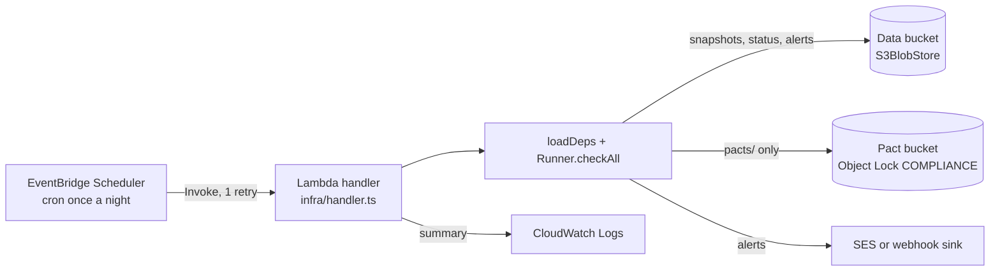

# Design: Nightly on AWS

Numbers (`AWS n.m`) refer to `requirements.md`.

## Decisions

| Decision | Choice | Why |
|---|---|---|
| Store routing | `PactRoutingBlobStore` sends hash-named snapshots (`pacts/<watch>/<sha256>.json`) to `S3ObjectLockBlobStore`, everything else, the `pact.json` record included, to the existing `S3BlobStore` | Reuses `GhostStore` and the S3 adapter unchanged (AWS 3.6, 3.8). The snapshot is the evidence and its name fixes its bytes; the record only points at it, so it may change. |
| Overwrites | Pre-check with a read, plus `IfNoneMatch: *` on the put | Refuses in code and again at the service (AWS 3.3, 3.4). Because only snapshots are locked, the posted mark, a replacement and a broken pact still work, and every snapshot ever sealed stays readable until its retain-until date (AWS 3.5, 3.10). |
| Retention | Per-object `ObjectLockRetainUntilDate` from the injected `Clock`, plus a bucket default | The code states the date explicitly; the bucket default covers writes from any other tool (AWS 3.2, 4.1). |
| Client | `clientFactory: () => S3Like`, called on first use | Tests pass fakes, nothing builds an SDK client at import (AWS 3.7). |
| Handler | `createHandler(options)` returns the Lambda function; `handler` is the default instance | Tests inject app, clock, fetcher and clients (AWS 2.6). |
| Template | SAM YAML in `infra/template.yaml`, esbuild bundling by `sam build` | No new npm dependency (AWS 4.8). |
| IAM | Inline policies with named actions on exact resources | AWS 4.4, 4.5. The function may put, get and list on the pact bucket, plus `s3:PutObjectRetention`, which Object Lock puts require. |

## Handler summary

`{ app, checked, changed, baseline, unchanged, skipped, blocked, failed, alerts }`, where `failed`
counts `error` results and `alerts` counts the alerts the pass raised (AWS 2.2, 2.4).

## Limits

The watched URLs belong to the app. The fixture apps point at `127.0.0.1`, so a real deployment
needs an app whose watches are real pages and a real `GHOST_CONTACT_URL`.
