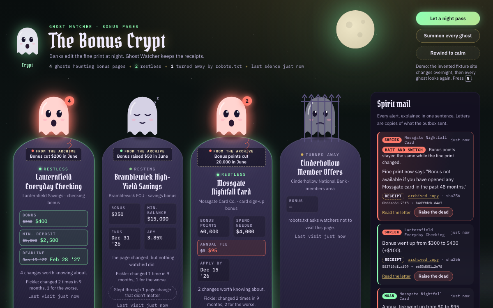
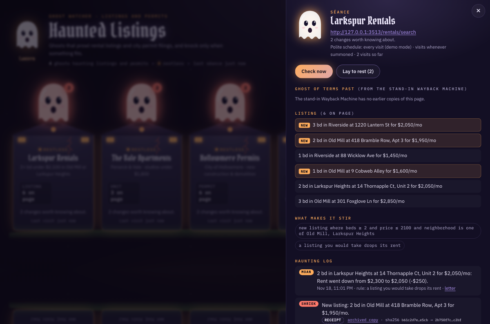
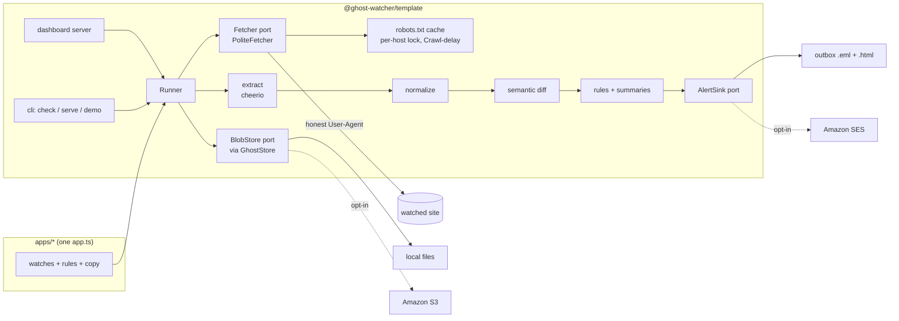

# Ghost Watcher

**Haunt the part of a web page you care about.** Ghost Watcher is a skeleton for building small,
polite page-change watchers. You name the regions of a page that matter (a bonus amount, a deadline,
the fine print, a table of listings), and a ghost checks them on a schedule. It ignores the noise:
timestamps, rotating banners, reordered lists, `$300` becoming `$300.00`. When something real
changes, the ghost wakes up and tells you in one plain sentence:

> Bonus went up from $300 to $400 (+$100).
> Fine print now says "A $12 monthly service fee applies unless you keep a $1,500 daily balance."
> New listing: 2 bd in Old Mill at 418 Bramble Row, Apt 3 for $1,950/mo.





This repo holds one reusable template and two apps built from it, each in its own folder:

| Folder | What it is |
| --- | --- |
| [`template/`](template/) | The skeleton: watch definitions, polite fetching, semantic diff, rules, alerts, storage, the haunted dashboard and the CLI |
| [`apps/bonus-watch/`](apps/bonus-watch/) | **The Bonus Crypt** watches bank and card sign-up bonus pages for changes to the amount, deposit, deadline and fine print |
| [`apps/listing-watch/`](apps/listing-watch/) | **Haunted Listings** watches rental listings and city building permits, and only speaks up about items that match your filters |

## Who it's for

- **Bonus hunters**, who track a dozen bank offers and miss the week a $300 bonus becomes $400, or
  the day "no monthly fee" quietly disappears from the fine print.
- **Renters and neighbors**, who want to hear about the 2-bedroom under $2,100 in their
  neighborhood, or the demolition permit on their street, without refreshing three sites a day.
- **Developers**, who need a small, honest watcher for any page and want the robots.txt handling,
  diffing and alerting already done.

## What works

- **Two complete apps on one skeleton.** Each app is a single `src/app.ts` of watch definitions,
  rules, copy and colors. Everything else comes from `@ghost-watcher/template`.
- **Polite fetching.** robots.txt is parsed per RFC 9309 (longest match wins, `*` and `$`
  wildcards, Crawl-delay) and cached. Disallowed pages are never requested. Every request sends an
  honest User-Agent (a contact URL, or an explicit local-only token for the fixture sites). Each URL has a minimum check interval, each host gets one
  request at a time, and errors trigger exponential back-off.
- **Semantic diff.** Values are normalized by kind (money, number, percent, date, URL, text) before
  comparing. Lists are matched by identity, so reordering is not a change. The first check records
  a baseline and never alerts.
- **Rules that read like intent.** `wentUp`, `wentDown`, `changed`, `appeared` and `disappeared`
  (optionally matching a phrase), plus `newItem`, `itemRemoved` and `itemChanged`, with filters
  such as `where.atMost('price', 2100)`. Each rule has a loudness: whisper, moan or shriek.
- **The Ghost of Terms Past.** On a ghost's first sighting it reads the page's archived copies from
  the Internet Archive's Wayback Machine (one per month, newest six) and runs them through the
  same extract, diff and rules. The séance opens with the page's history instead of a blank:
  "Mar 4: Bonus $500. Jun 11: Bonus went down from $500 to $300 (-$200)." Past changes are shown,
  never sent as alerts. In `demo` mode the fixture site stands in for the archive, and the adapter's
  tests replay real recorded Wayback responses.
- **Bait and switch.** `rules.stealthEdit('finePrint', ['bonus'])` notices when the fine print changes
  while the headline offer stays put. In the demo, Mossgate keeps its 60,000 points but slips a
  48-month eligibility window into the terms; Spirit mail and the email lead with a "Bait and switch"
  banner instead of a routine fine-print note.
- **Plain-English alerts.** The outbox writes each alert as an `.eml` file, an HTML preview and an
  index line. It works with no accounts. Amazon SES is an opt-in adapter.
- **A haunted dashboard.** Each watch is a ghost on a tombstone. It sleeps while nothing changes,
  glows when something does, and fades when robots.txt says no or the page's layout has changed.
  Click a ghost to open the séance: what is on the page now, what it said before, and a word-level
  diff of the fine print. From there you can **Check now** or **Lay to rest**, or summon every ghost at once. The
  dashboard works from the keyboard, respects reduced motion, and is readable on a phone.
- **Safe to leave running.** The dashboard answers only to `localhost` and loopback Host headers
  (plus any listed in `GHOST_ALLOWED_HOSTS`), which stops DNS-rebinding pages. Every POST must come
  from the dashboard's own origin, so another web page cannot make the ghosts go out and fetch.
- **Tests that drive the real thing.** Unit tests cover every module. CLI tests run the real
  `check` command against a local fixture site. Playwright drives both dashboards in a browser,
  including phone width, keyboard-only use and reduced motion.
  Every test runs against `127.0.0.1`; none touch a live site.

## Signal, not noise

`npm run noise` runs the same three nights of both fixture sites, checked every 6 hours, through
three watchers that see the exact same responses: a whole-page watcher (alerts when the page's
visible text changes, as a watcher with no filter does), a selector text watcher (the same CSS
selectors Ghost Watcher uses, compared as raw text), and Ghost Watcher. Each cell is alerts sent
(false alarms, changes missed). Vitest pins these numbers, so they cannot drift from the code.

| App | Checked | Changes worth knowing | Whole-page watcher | Selector text watcher | Ghost Watcher |
| --- | --- | --- | --- | --- | --- |
| The Bonus Crypt | 3 pages, 33 visits | 4 | 33 (29 false, 0 missed) | 5 (1 false, 0 missed) | 4 (0 false, 0 missed) |
| Haunted Listings | 4 pages, 44 visits | 6 | 44 (38 false, 0 missed) | 6 (0 false, 0 missed) | 6 (0 false, 0 missed) |
| **Total** | 7 pages, 77 visits | 10 | **77 (67 false, 0 missed)** | **11 (1 false, 0 missed)** | **10 (0 false, 0 missed)** |

The fixture pages are invented, but their noise is typical: a generated-at timestamp, a request id
and a rotating promo on every page, plus one night where a bank only reformats its offer. The
"changes worth knowing" are listed next to each fixture site (`bonusWorthKnowing`,
`listingWorthKnowing`). The dashboard shows the same count live: each stone says how many page
changes its ghost slept through, and every night's toast reads like
"3 pages changed: 2 worth waking for, 1 ignored as noise."

## How to run

You need Node.js 20.11 or newer.

```sh
npm install
npm run bonus      # The Bonus Crypt at http://127.0.0.1:3130 (fixture bank site on :3131)
npm run listing    # Haunted Listings at http://127.0.0.1:3132 (fixture city site on :3133)
```

`demo` starts the app's local fixture site, takes the first sighting of every page (a baseline,
so no alerts yet), and opens the dashboard against it. To try it:

1. Open the dashboard. Every ghost is resting, and one is behind bars because robots.txt keeps it out.
2. Click **Let a night pass**. The invented fixture site moves to its next version and every ghost
   looks again. The ghosts whose pages really changed start to glow, and the alert letters appear
   in the **Spirit mail** feed. Each app has two nights of changes.

The button exists only in `demo` mode. Outside the browser, the same step is
`curl -X POST http://127.0.0.1:3131/__fixture/advance` (`:3133` for listings) followed by
**Summon every ghost**.

Each app also has a command line:

```sh
cd apps/bonus-watch
npx tsx src/main.ts list                    # the watches and their rules
npx tsx src/main.ts check                   # check every watch once (respects intervals)
npx tsx src/main.ts check --force --json    # check now, machine-readable
npx tsx src/main.ts serve --port 3130       # dashboard plus a polite scheduler against BONUS_SITE_ORIGIN
```

Runtime data (snapshots, status, alerts and the outbox) goes to `.ghost-data/` in the app folder.
It is git-ignored.

## How to test

```sh
npm test               # type-check, then unit and CLI tests, then Playwright end to end
npm run test:unit      # Vitest only
npm run test:e2e       # Playwright only (run `npx playwright install chromium` once first)
npm run noise          # print the noise-ratio table above
```

Playwright starts the fixture sites and dashboards itself on ports 3134 to 3139 (3138-3139 run one app in `demo` mode).

## Architecture



One check runs these steps: check the interval and back-off → fetch (robots.txt first) → extract
the watched regions → normalize → diff against the last snapshot → evaluate the rules → write
plain-English summaries → deliver one alert message → save the snapshot and status. A page with
none of the watched regions counts as an error ("the layout may have changed"). It never produces
a false alert.

The dashboard is server-rendered by `node:http` with no framework and no build step. The same
`render.js` runs on the server and in the browser for live refreshes, and a strict Content Security
Policy is set on every page.

## Adapters: local vs real

Every external service sits behind a port. The free local adapter is the default. A real adapter
is selected by environment variable and loaded only when selected.

| Port | Local (default) | Real (opt-in) | Select with |
| --- | --- | --- | --- |
| Storage | `FileBlobStore` under `.ghost-data/` (`MemoryBlobStore` for tests) | `S3BlobStore` (AWS SDK v3) | `GHOST_STORE=file\|memory\|s3`, `GHOST_S3_BUCKET`, `GHOST_S3_PREFIX`, `AWS_REGION` |
| Alerts | `OutboxAlertSink` (`.eml`, HTML preview, `outbox.jsonl`), `ConsoleAlertSink` | `SesEmailAlertSink` (SES v2), `WebhookAlertSink` (ntfy, Discord, Slack or plain JSON) | `GHOST_ALERTS=outbox,console,ses,webhook` (comma-separated), `GHOST_SES_FROM`, `GHOST_ALERT_TO`, `GHOST_WEBHOOK_URL`, `GHOST_WEBHOOK_FORMAT` |
| Fetching | `PoliteFetcher` over `fetch` | the same fetcher, pointed at real sites | `GHOST_CONTACT_URL`, `GHOST_HOST_GAP_MS`, `GHOST_TIMEOUT_MS` |
| History | off (`demo` uses the fixture site's stand-in archive) | `WaybackHistorySource` (Internet Archive CDX API, free, no key) | `GHOST_HISTORY=wayback`, `GHOST_HISTORY_BASE`, `GHOST_HISTORY_LIMIT` |
| Dashboard access | loopback hosts only | a deployed hostname | `GHOST_ALLOWED_HOSTS` (comma-separated; Render's `RENDER_EXTERNAL_HOSTNAME` is added automatically) |
| Clock | `systemClock` | `manualClock` in tests | none |

The S3 and SES adapters are written and type-checked, and they are tested with fake clients. They
have never been run against AWS. A misconfigured selection fails at startup with a message that
names the missing variable.

**Deploy target (free, not deployed):** a Render free web service running
`npm run serve -w @ghost-watcher/bonus-watch` (or the listing app). Free instances sleep and do not
keep files across restarts. For durable state, use the S3 adapter.

**Contact URL.** The apps ship without a contact URL. While every watch is on this machine or on a
documentation-only domain (the fixture and demo sites), the User-Agent says
`local-only, no public contact`. The watcher refuses to start if any watch points at a real
third-party site and `GHOST_CONTACT_URL` is unset or names a documentation-only domain such as
`example.com`, so set it to a page you control before watching live sites. A placeholder is never
sent as a contact.

## Built with Kiro

Kiro planned this repo before any code was written. Everything it used and produced is in
[`.kiro/`](.kiro/):

- [`.kiro/steering/`](.kiro/steering/): product, tech and structure steering files, always included.
- [`.kiro/specs/ghost-watcher-kit/`](.kiro/specs/ghost-watcher-kit/): requirements in EARS notation,
  the design, and the task list. Kiro generated all three. Every task is now checked off, with
  implementation notes.
- [`.kiro/hooks/`](.kiro/hooks/): a hook that type-checks and runs the unit tests when a source or test
  file under `template/`, `apps/` or `e2e/` is saved, one that runs the full suite when an agent turn
  ends, and an agent hook (`money-guard`) that restates the integer-cents money rule when
  `normalize.ts`, `diff.ts` or `rules.ts` is saved. They use Kiro's `v1` hook file format
  (`PostFileSave` and `Stop` triggers), which Kiro IDE 1.0 and CLI V3 load from `.kiro/hooks/*.json`.

[`KIRO-LOG.md`](KIRO-LOG.md) records each Kiro call: the exact prompt, the files produced, the
errors hit along the way, and the one requirement that was revised by hand.

A three-minute walkthrough for a demo video is in [`docs/demo-script.md`](docs/demo-script.md).

## Disclaimer

The banks, buildings, people and addresses in the fixtures are invented. The Bonus Crypt reports
what a page says. It is not financial advice.

## License

MIT © 2026 Stubborn Otter Software
