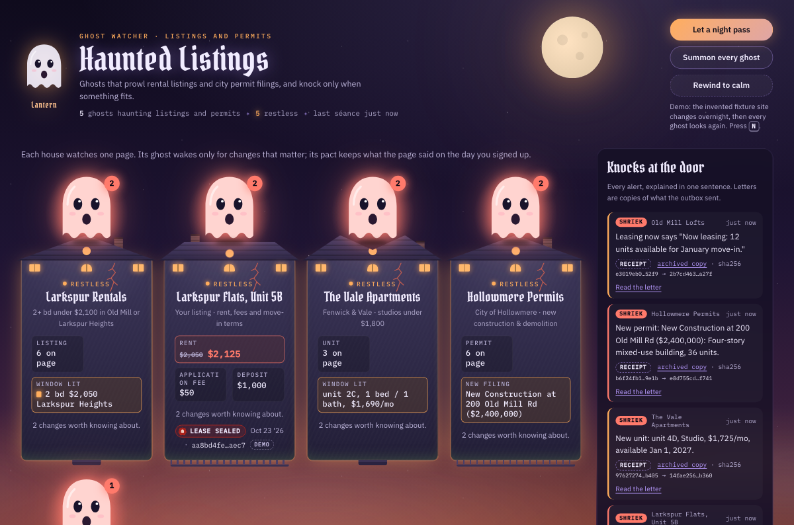

# Ghost Watcher

**Live demo: [ghost-watcher.pages.dev](https://ghost-watcher.pages.dev/)** (a static recording of the Bonus Crypt; press **Let a night pass**)

**Banks edit the fine print at night. Ghost Watcher keeps the receipts.**

**Bonus never paid? Show the bank its own terms from the day you applied.** Ghost Watcher watches the
few bank and card offer pages you applied to, wakes only for changes that matter (10 alerts where a
whole-page watcher sent 77, none false, none missed), and keeps dated, hashed, archived proof of
every bonus cut and fine-print edit, with a dispute letter ready to send. For a bonus hunter that is
$2,000 to $5,000 a year riding on pages that change without notice.

It happens to real customers. In July 2023 the CFPB found that Bank of America had
["illegally withheld promised credit card account bonuses"](https://www.consumerfinance.gov/about-us/newsroom/bank-of-america-for-illegally-charging-junk-fees-withholding-credit-card-rewards-opening-fake-accounts/)
from tens of thousands of consumers, part of an order that included $90 million in CFPB penalties.
The CFPB's public complaint database holds **22,055 complaints** filed as "didn't receive advertised
or promotional terms" (credit cards) or "didn't receive terms that were advertised" (opening a
checking or savings account) ([queries](docs/sources.md), checked 2026-11-18).

[Try it in 60 seconds](#try-it-in-60-seconds) · [Signal, not noise](#signal-not-noise) ·
[Why not what you already use?](#why-not-what-you-already-use) · [Judges' map](JUDGES.md) ·
[Kiro log](KIRO-LOG.md) · [Full details](docs/details.md)


### For judges

Kiroween 2026, **Skeleton Crew**: one template, two apps that look and behave differently (the Bonus
Crypt and Haunted Listings), each a single `app.ts` on the shared skeleton.

| | Where to look |
| --- | --- |
| 60 seconds | `npm install && npm run bonus`, open http://127.0.0.1:3130/?night=1 (the night passes as it loads), then **Raise the dead** on the Bait and switch letter |
| Criteria to evidence | [JUDGES.md](JUDGES.md): each judging criterion mapped to files, commands and numbers |
| Spec | [`.kiro/specs/ghost-watcher-kit/`](.kiro/specs/ghost-watcher-kit/): EARS requirements, design and task list written by Kiro, then reviewed by Kiro against the code. [`.kiro/specs/seal-the-pact/`](.kiro/specs/seal-the-pact/): the headline feature, specced and then built by Kiro |
| Steering and hooks | [`.kiro/steering/`](.kiro/steering/) (always included) and [`.kiro/hooks/`](.kiro/hooks/): tests on save, the full suite on Stop (it caught a stale assertion that Kiro then fixed), and Kiro's `money-guard` agent hook |
| Who wrote what | [KIRO-LOG.md](KIRO-LOG.md#who-wrote-what) |
| Tests | `npm test`: type-check, 353 Vitest tests and 27 Playwright tests, all against `127.0.0.1` |

### Try it in 60 seconds

```sh
npm install
npm run bonus      # open http://127.0.0.1:3130/?night=1
```

Everything runs on your machine against an invented bank site. No accounts, keys or live sites.
Without `?night=1`, click **Let a night pass** (or press <kbd>N</kbd>); **Rewind to calm** starts
over. `npm run listing` opens Haunted Listings on port 3132.

The [live site](https://ghost-watcher.pages.dev/) is a static recording of this demo (`npm run build:static`), so it watches no real
pages; watching real pages needs the Node server (`npm run bonus`).

## What one night looks like (demo data, invented banks)

> Bonus went up from $300 to $400 (+$100).
>
> **Bait and switch:** Bonus points stayed the same while the fine print changed. Fine print now says
> "Bonus not available if you have opened any Mossgate card in the past 48 months."

Before a single night has passed, the **Ghost of Terms Past** reads each page's archived copies: the
Lanternfield bonus was $500 in March and cut to $300 in June. When the first night raises it to $400,
the ghost shrieks; when Mossgate slips an eligibility window under an unchanged headline, the letter
leads with **Bait and switch**. Each of those keeps a **receipt** (the SHA-256 of the page before and
after, plus a permanent copy from the Internet Archive's Save Page Now), and **Raise the dead** turns
the receipt into a dispute pack: a letter to the bank with the old and new terms and their dates, the
archived link and both hashes, and prefilled CFPB complaint text. Bramblewick only reformatted its
page, and its ghost slept straight through it.

**Seal the pact.** On the day you apply, press **I applied today** on the bank's stone in the Bonus
Crypt. The ghost seals that page as your pact: the snapshot, its SHA-256, a permanent copy from the
Internet Archive when archiving is on, and the date. From then on every change is judged against the
pact as well as against last night, so a slow drift in small steps still raises a flag, and the dispute
pack quotes what the page promised the day you applied against what it says now. When the bank
improves its terms after you applied, the pack becomes a **bonus match** letter that asks for the
better terms. Replacing or breaking a pact always asks first. In the demo the pact is back-dated 40
days, so the first night already reads "Oct 10, the day you applied" against "Nov 19, what it says
now" (the date depends on the day you run it), and the demo pact has no archived copy because none
could honestly be dated that far back.


## Who it's for

**Bonus hunters.** r/churning has roughly 678,000 members
([The Hive Index](https://thehiveindex.com/communities/r-churning/), checked 2026-11-18), and Doctor
of Credit's rule of thumb is that it is
["generally OK to open 10 or less bank accounts each year"](https://www.doctorofcredit.com/how-many-bank-accounts-can-i-safely-open-within-a-year-for-bank-bonus-purposes/).
At $200 to $500 a bonus, that is $2,000 to $5,000 a year.

*An illustrative scenario, not a real customer:* Maya opens a $300 checking bonus. Nine days later
the page says $400, and a $12 monthly fee has appeared in the fine print. Ghost Watcher wakes her the
next morning with both changes in two sentences, and when the bonus does not post, she sends the
bank its own terms from the day she applied. At about $4 a month, it pays for itself if it catches
one $100 change every two years.

**Same skeleton, other hauntings.** Haunted Listings watches rentals and building permits on a dusk
street where each house names the unit that lit its window, and any page that deserves a ghost is one
`app.ts` away.



## Signal, not noise

It never cries wolf. `npm run noise` replays the same three nights of both fixture sites, checked
every 6 hours, through three watchers that see the exact same responses. Each cell is alerts sent
(false alarms, changes missed); Vitest pins the numbers.

| App | Checked | Changes worth knowing | Whole-page watcher | Selector text watcher | Ghost Watcher |
| --- | --- | --- | --- | --- | --- |
| The Bonus Crypt | 3 pages, 33 visits | 4 | 33 (29 false, 0 missed) | 5 (1 false, 0 missed) | 4 (0 false, 0 missed) |
| Haunted Listings | 4 pages, 44 visits | 6 | 44 (38 false, 0 missed) | 6 (0 false, 0 missed) | 6 (0 false, 0 missed) |
| **Total** | 7 pages, 77 visits | 10 | **77 (67 false, 0 missed)** | **11 (1 false, 0 missed)** | **10 (0 false, 0 missed)** |

The fixture pages are invented, but their noise is typical: timestamps, request ids, rotating promos
and one night where a bank only reformats its offer. `scripts/real-pages.ts` replays a real page's
Wayback Machine history through the same three watchers ([procedure](docs/real-pages.md)).

## Why not what you already use?

| | What it does well | Where Ghost Watcher differs |
| --- | --- | --- |
| [Doctor of Credit](https://www.doctorofcredit.com/) and [r/churning](https://www.reddit.com/r/churning/) | The best place to find offers and readers' data points | They cover popular offers after the fact. Ghost Watcher watches the exact pages you applied to, catches fine-print edits nobody posts, and keeps a dated receipt you can send the bank |
| [changedetection.io](https://github.com/dgtlmoon/changedetection.io) | Open source, self-hosted or $8.99/month hosted; CSS, XPath and JSONPath filters, many notification channels | Its README leaves robots.txt to the user; Ghost Watcher enforces it and identifies itself honestly. Values are typed (money in integer cents, dates in days), so alerts state the change |
| [Visualping](https://visualping.io) and [Distill.io](https://distill.io) | Hosted visual and text monitoring with AI change summaries | Whether a change matters is decided by rules you can read and unit-test, not a model, and receipts and dispute letters are built in |

Feature details were checked against each product's own pages on 2026-11-18; the sources are in
[docs/details.md](docs/details.md#what-only-ghost-watcher-does).

## Built with Kiro

Kiro specced and built the headline feature, **Seal the pact**: it wrote
`.kiro/specs/seal-the-pact/` (91 EARS criteria, 27 tasks) and then all of its code and tests in two
`kiro-cli` sessions (4,526 lines, 120 Vitest and 10 Playwright tests, 52.95 credits), with no line
fixed by hand. Kiro also wrote the spec the skeleton is built against, reviewed it against the code,
built the integer-cents money change, the contact-URL policy and the overridable e2e ports, and wrote
the `money-guard` agent hook. Its hooks run the tests on save and the full suite when an agent turn
ends (which caught a stale assertion Kiro then fixed). The skeleton's first version and the earlier
features were written against Kiro's spec with another AI coding assistant.
[KIRO-LOG.md](KIRO-LOG.md) records every Kiro call, its transcript and who wrote what.

## Beyond Kiroween

- **Free to self-host.** MIT-licensed; runs on one machine with no accounts. S3, SES and webhook
  (ntfy, Discord, Slack) adapters are there for running it unattended.
- **Personal, about $4 a month.** 25 hosted ghosts, phone alerts and a weekly digest, priced under
  general watchers (changedetection.io hosted is $8.99/month; Visualping Personal is $14/month).
- **Pro, about $49 a month.** For people who watch offer terms for a living: bonus-comparison and
  affiliate sites that must keep every offer they list accurate, and bank marketing-compliance
  teams watching their own and competitors' disclosures. Rough market math: there are 4,379
  FDIC-insured banks ([FDIC, Q3 2025](https://fdic.gov/news/press-releases/2025/fdic-insured-institutions-reported-return-assets-127-percent-and-net));
  if 2% of them used Pro, that is about $52,000 a year before credit unions, card issuers and
  comparison sites. Visualping reports roughly 35,000 users tracking legal pages and 11,000 tracking
  regulatory compliance ([its own figures](https://visualping.io/blog/visualping-enterprise-evolution)).
- **Why now.** The FTC's fees rule (in force since 2025-05-12,
  [Federal Register](https://www.govinfo.gov/content/pkg/FR-2025-01-10/html/2024-30293.htm)) makes live-event tickets and
  short-term lodging show the total price up front, but it does not reach bank or card offers, where
  a new fee still arrives as an edit to the fine print.

How to run, test, the architecture and every adapter are in [docs/details.md](docs/details.md).
Notable changes are in [CHANGELOG.md](CHANGELOG.md).

## Disclaimer

The banks, buildings, people and addresses in the fixtures are invented. The Bonus Crypt reports
what a page says. It is not financial or legal advice, and a dispute pack is a starting point you
review and send yourself.

## License

MIT © 2026 Stubborn Otter Software
