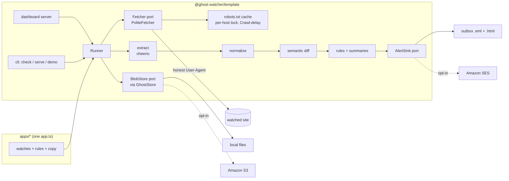

# Ghost Watcher in detail

The [README](../README.md) is the short version. This page has the full feature list, how to run
and test everything, the architecture and the adapters.

- [What works](#what-works)
- [How to run](#how-to-run)
- [How to test](#how-to-test)
- [Architecture](#architecture)
- [Adapters: local vs real](#adapters-local-vs-real)

## What works

- **Two complete apps on one skeleton.** Each app is a single `src/app.ts` of watch definitions,
  rules, copy and colors. Everything else comes from `@ghost-watcher/template`.
- **Polite fetching.** robots.txt is parsed per RFC 9309 (longest match wins, `*` and `$`
  wildcards, Crawl-delay) and cached. Disallowed pages are never requested. Every request sends an
  honest User-Agent (a contact URL, or an explicit local-only token for the fixture sites). Each URL has a minimum check interval, each host gets one
  request at a time, and errors trigger exponential back-off.
- **Semantic diff.** Values are normalized by kind (money, number, percent, date, URL, text) before
  comparing. Lists are matched by identity, so reordering is not a change. The first check records
  a baseline and never alerts.
- **Rules that read like intent.** `wentUp`, `wentDown`, `changed`, `appeared` and `disappeared`
  (optionally matching a phrase), plus `newItem`, `itemRemoved` and `itemChanged`, with filters
  such as `where.atMost('price', 2100)`. Each rule has a loudness: whisper, moan or shriek.
- **The Ghost of Terms Past.** On a ghost's first sighting it reads the page's archived copies from
  the Internet Archive's Wayback Machine (one per month, newest six) and runs them through the
  same extract, diff and rules. The séance opens with the page's history instead of a blank:
  "Mar 4: Bonus $500. Jun 11: Bonus went down from $500 to $300 (-$200)." The stone wears the
  biggest past change as a ribbon ("Bonus cut $200 in June"), carries a fickleness score ("changed
  2 times in 9 months, 1 for the worse"), and Spirit mail starts with dimmed letters from the
  archive, so the dashboard has a story to tell before the first night. Past changes are shown,
  never sent as alerts. In `demo` mode the fixture site stands in for the archive, and the adapter's
  tests replay real recorded Wayback responses.
- **Bait and switch.** `rules.stealthEdit('finePrint', ['bonus'])` notices when the fine print changes
  while the headline offer stays put. In the demo, Mossgate keeps its 60,000 points but slips a
  48-month eligibility window into the terms; Spirit mail and the email lead with a "Bait and switch"
  banner instead of a routine fine-print note.
- **The ghost keeps receipts.** Every shriek and every bait and switch carries proof of what the page
  said: the SHA-256 of the stored snapshot before the change and of the one after it, plus, with
  `GHOST_RECEIPTS=archive`, a permanent copy of the page from the Internet Archive's Save Page Now.
  The letter, Spirit mail and the séance all show it, so you can show the bank its own terms from
  the day you applied. Demo mode archives to the fixture site's stand-in Wayback Machine.
- **Raise the dead.** In the Bonus Crypt, every change that kept a receipt has a **Raise the dead**
  button. It opens a dispute pack: a letter to the bank quoting what the page said before and after,
  with dates, the archived copy and both hashes, plus prefilled CFPB complaint text filed under the
  CFPB's own product and issue ("Didn't receive advertised or promotional terms" for cards, "Didn't
  receive terms that were advertised" for deposit accounts). Blanks only the reader knows stay in
  brackets, and nothing is sent for them. `disputePack()` is pure, so the same change always gives
  the same letter.
- **A demo that opens on the night.** In demo mode, `?night=1` passes the first night as the page
  loads, and **Rewind to calm** returns to the first sighting.
- **Plain-English alerts.** The outbox writes each alert as an `.eml` file, an HTML preview and an
  index line. It works with no accounts. Amazon SES is an opt-in adapter.
- **Two apps look like two apps.** The Bonus Crypt's ghosts haunt tombstones under a moon that
  turns red on a shriek; Haunted Listings' ghosts haunt gabled houses on a dusk street, and each
  house names the unit that lit its window ("2 bd $2,050 Larkspur Heights"). Spirit mail is
  "Knocks at the door" there.
  Each app sets its colors, crest word and motif in one `theme` line.
- **A haunted dashboard.** Each watch is a ghost on a tombstone. It sleeps while nothing changes,
  glows when something does, and fades when robots.txt says no or the page's layout has changed.
  Click a ghost to open the séance: what is on the page now, what it said before, and a word-level
  diff of the fine print. From there you can **Check now** or **Lay to rest**, or summon every ghost at once. The
  dashboard works from the keyboard, respects reduced motion, is readable on a phone, and passes an
  axe-core WCAG 2.1 AA scan in every state a demo night leaves behind. A changed value shows on its
  stone, old value struck through, until you read the alert, colored by what it means for you: a
  field declares which way is better (`better: 'higher'` for a bonus, `'lower'` for a fee), so a
  raised fee turns red, a bigger bonus glows, and a value that vanished reads "gone". A shriek gets
  its own scene: the moon flushes red, lightning flashes and the stone cracks. Press <kbd>N</kbd> in
  demo mode to let a night pass.
- **Safe to leave running.** The dashboard answers only to `localhost` and loopback Host headers
  (plus any listed in `GHOST_ALLOWED_HOSTS`), which stops DNS-rebinding pages. Every POST must come
  from the dashboard's own origin, so another web page cannot make the ghosts go out and fetch.
- **Tests that drive the real thing.** Unit tests cover every module. CLI tests run the real
  `check` command against a local fixture site. Playwright drives both dashboards in a browser,
  including phone width, keyboard-only use and reduced motion.
  Every test runs against `127.0.0.1`; none touch a live site.

## How to run

You need Node.js 20.11 or newer.

```sh
npm install
npm run bonus      # The Bonus Crypt at http://127.0.0.1:3130 (fixture bank site on :3131)
npm run listing    # Haunted Listings at http://127.0.0.1:3132 (fixture city site on :3133)
```

`demo` starts the app's local fixture site, takes the first sighting of every page (a baseline,
so no alerts yet), and opens the dashboard against it. To try it:

1. Open the dashboard. Every ghost is resting, and one is behind bars because robots.txt keeps it out.
2. Click **Let a night pass**. The invented fixture site moves to its next version and every ghost
   looks again. The ghosts whose pages really changed start to glow, and the alert letters appear
   in the **Spirit mail** feed. Each app has two nights of changes.

The button exists only in `demo` mode. Outside the browser, the same step is
`curl -X POST http://127.0.0.1:3131/__fixture/advance` (`:3133` for listings) followed by
**Summon every ghost**.

Each app also has a command line:

```sh
cd apps/bonus-watch
npx tsx src/main.ts list                    # the watches and their rules
npx tsx src/main.ts check                   # check every watch once (respects intervals)
npx tsx src/main.ts check --force --json    # check now, machine-readable
npx tsx src/main.ts serve --port 3130       # dashboard plus a polite scheduler against BONUS_SITE_ORIGIN
```

Runtime data (snapshots, status, alerts and the outbox) goes to `.ghost-data/` in the app folder.
It is git-ignored.

## How to test

```sh
npm test               # type-check, then unit and CLI tests, then Playwright end to end
npm run test:unit      # Vitest only
npm run test:e2e       # Playwright only (run `npx playwright install chromium` once first)
npm run noise          # print the noise-ratio table above
npm run hero           # re-record docs/bonus-crypt-night.gif from the demo (needs ffmpeg)
npm run stills         # re-take the README screenshots from both demos
npm run build:static   # record the Bonus Crypt demo into dist/ as a static site (no server needed)
```

[`.github/workflows/test.yml`](../.github/workflows/test.yml) runs the same `npm test` on pushes to
`main` and on pull requests. Notable changes are listed in [`CHANGELOG.md`](../CHANGELOG.md).

Playwright starts the fixture sites and dashboards itself on ports 3134 to 3141 (3138-3141 run each app in `demo` mode).
Set `GHOST_E2E_PORT` to move the whole block: it is the base port (default 3134, allowed 1024 to 65528) and the eight servers use base+0 to base+7, so parallel CI runs do not collide.

## Architecture



One check runs these steps: check the interval and back-off → fetch (robots.txt first) → extract
the watched regions → normalize → diff against the last snapshot → evaluate the rules → write
plain-English summaries → deliver one alert message → save the snapshot and status. A page with
none of the watched regions counts as an error ("the layout may have changed"). It never produces
a false alert.

The dashboard is server-rendered by `node:http` with no framework and no build step. The same
`render.js` runs on the server and in the browser for live refreshes, and a strict Content Security
Policy is set on every page.

## Adapters: local vs real

Every external service sits behind a port. The free local adapter is the default. A real adapter
is selected by environment variable and loaded only when selected.

| Port | Local (default) | Real (opt-in) | Select with |
| --- | --- | --- | --- |
| Storage | `FileBlobStore` under `.ghost-data/` (`MemoryBlobStore` for tests) | `S3BlobStore` (AWS SDK v3) | `GHOST_STORE=file\|memory\|s3`, `GHOST_S3_BUCKET`, `GHOST_S3_PREFIX`, `AWS_REGION` |
| Alerts | `OutboxAlertSink` (`.eml`, HTML preview, `outbox.jsonl`), `ConsoleAlertSink` | `SesEmailAlertSink` (SES v2), `WebhookAlertSink` (ntfy, Discord, Slack or plain JSON) | `GHOST_ALERTS=outbox,console,ses,webhook` (comma-separated), `GHOST_SES_FROM`, `GHOST_ALERT_TO`, `GHOST_WEBHOOK_URL`, `GHOST_WEBHOOK_FORMAT` |
| Fetching | `PoliteFetcher` over `fetch` | the same fetcher, pointed at real sites | `GHOST_CONTACT_URL`, `GHOST_HOST_GAP_MS`, `GHOST_TIMEOUT_MS` |
| History | off (`demo` uses the fixture site's stand-in archive) | `WaybackHistorySource` (Internet Archive CDX API, free, no key) | `GHOST_HISTORY=wayback`, `GHOST_HISTORY_BASE`, `GHOST_HISTORY_LIMIT` |
| Receipts | SHA-256 of the before and after snapshots | `SavePageNowArchiver` (Internet Archive Save Page Now, free, no key) | `GHOST_RECEIPTS=hashes\|archive`, `GHOST_ARCHIVE_BASE` |
| Dashboard access | loopback hosts only | a deployed hostname | `GHOST_ALLOWED_HOSTS` (comma-separated) |
| Clock | `systemClock` | `manualClock` in tests | none |

**Checking a receipt.** A receipt's hashes are taken over the exact bytes of the snapshot files, so
anyone holding the data folder can confirm them:
`shasum -a 256 .ghost-data/store/snapshots/<watch-id>/history/*.json` lists the same values the letter
quotes. The archived copy lives with the Internet Archive, outside your machine.

The S3 and SES adapters are written and type-checked, and they are tested with fake clients. They
have never been run against AWS. A misconfigured selection fails at startup with a message that
names the missing variable.

**Contact URL.** The apps ship without a contact URL. While every watch is on this machine or on a
documentation-only domain (the fixture and demo sites), the User-Agent says
`local-only, no public contact`. The watcher refuses to start if any watch points at a real
third-party site and `GHOST_CONTACT_URL` is unset or names a documentation-only domain such as
`example.com`, so set it to a page you control before watching live sites. A placeholder is never
sent as a contact.

## What only Ghost Watcher does

Also only here: the **Ghost of Terms Past** (a page's history from the Wayback Machine on the first
sighting), the **bait-and-switch** rule, the [measured noise table](../README.md#signal-not-noise), and the fact
that it is a template: each app above is one `app.ts` file plus a fixture site and tests.

Feature details checked against each product's own pages on 2026-11-18:
[changedetection.io README](https://github.com/dgtlmoon/changedetection.io),
[Visualping pricing](https://visualping.io/business/pricing/),
[Visualping AI](https://visualping.io/blog/visualping-ai),
[Distill conditions](https://distill.io/docs/web-monitor/using-conditions-to-get-alert-on-important-changes/),
[Distill AI change summary](https://distill.io/docs/web-monitor/ai-change-summary/).

